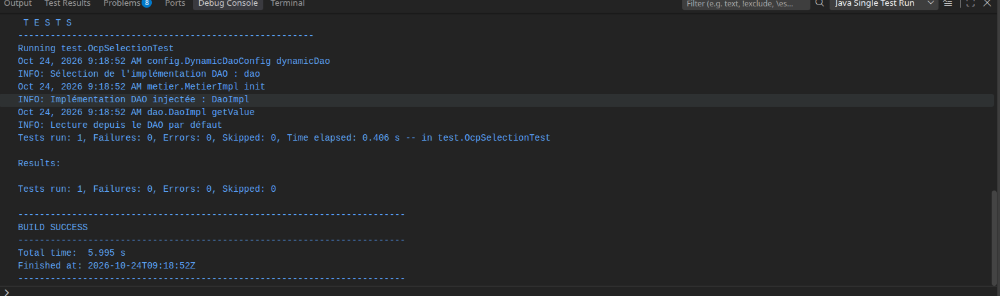
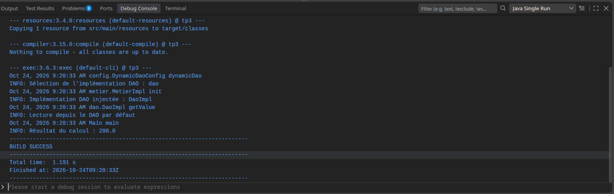

# TP Spring : injection et sélection d'un DAO

Ce projet montre comment injecter une implémentation de `IDao` dans
`MetierImpl`, puis comment choisir cette implémentation avec Spring.

## Lancer le projet

Le projet utilise Java 8+ et Maven :

```bash
mvn clean test
```

Pour exécuter `Main` depuis un IDE, lancez la classe `Main`. Le profil
`prod` est activé **avant** le rafraîchissement du contexte Spring, puis le
contexte est fermé proprement.

Les messages de suivi (`TRACE` fonctionnel, sélection du DAO et lecture de la
valeur) utilisent `java.util.logging.Logger`. Il n'y a plus de
`System.out.println` dans le code applicatif.

## Les trois formes d'injection Spring

### 1. Injection par constructeur (utilisée ici)

```java
@Service
class MetierImpl {
    private final IDao dao;

    MetierImpl(IDao dao) {
        this.dao = dao;
    }
}
```

C'est la forme recommandée : la dépendance est obligatoire, le champ peut
rester `final`, et la classe est facilement testable sans réflexion.

### 2. Injection par setter

```java
@Service
class MetierAvecSetter {
    private IDao dao;

    @Autowired
    void setDao(IDao dao) {
        this.dao = dao;
    }
}
```

Elle est utile quand la dépendance est optionnelle ou doit pouvoir être
remplacée après la construction. Elle nécessite une validation si la
dépendance est en réalité obligatoire.

### 3. Injection par champ

```java
@Service
class MetierAvecChamp {
    @Autowired
    private IDao dao;
}
```

Elle est courte, mais elle masque les dépendances et rend les tests unitaires
plus difficiles. Elle est donc présentée à titre pédagogique, pas utilisée
dans le code principal.

## `@Bean`, `@Primary` et sélection par propriété

`DynamicDaoConfig` déclare un bean avec `@Bean`. La méthode lit
`dao.target` depuis [app.properties](src/main/resources/app.properties), crée
l'implémentation correspondante et la marque `@Primary`. Ainsi, quand plusieurs
beans implémentent `IDao`, l'injection par constructeur de `MetierImpl` choisit
le bean dynamique sans ajouter de `@Qualifier`.

Valeurs disponibles :

```properties
dao.target=dao
# dao.target=dao2
# dao.target=daoFile
# dao.target=daoApi
```

Le changement de propriété ne demande aucune modification de `MetierImpl`.
Une valeur inconnue provoque explicitement une `IllegalArgumentException`
plutôt qu'une sélection silencieuse.

Le bean `daoProd` montre aussi la sélection par profil :

```java
@Component("daoProd")
@Profile("prod")
class DaoImplProd implements IDao { ... }
```

Le profil doit être activé avant `refresh()` :

```java
AnnotationConfigApplicationContext context =
        new AnnotationConfigApplicationContext();
context.getEnvironment().setActiveProfiles("prod");
context.register(AppConfig.class);
context.refresh();
```

## Traçabilité / tracktrace

Le chemin d'exécution est observable dans les logs :

1. `DynamicDaoConfig` journalise la valeur de `dao.target`.
2. `MetierImpl` journalise la classe effectivement injectée dans `@PostConstruct`.
3. Le DAO sélectionné journalise la source de la valeur.
4. `Main` journalise le résultat final du calcul.

La formule reste `dao.getValue() * 2`. Avec `dao.target=dao`, le résultat
attendu est `200.0`.




